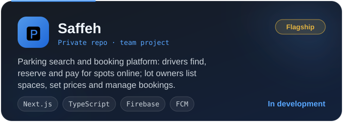
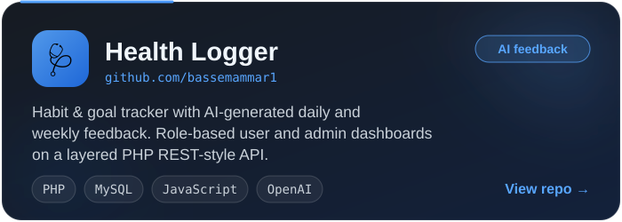
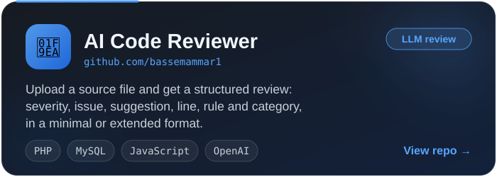
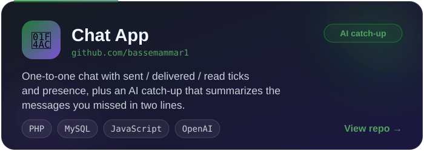
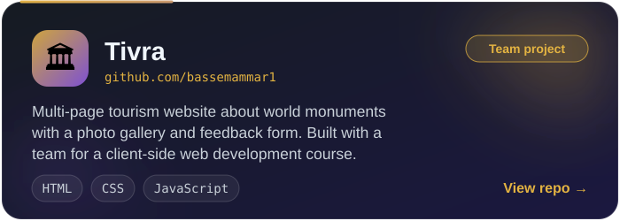
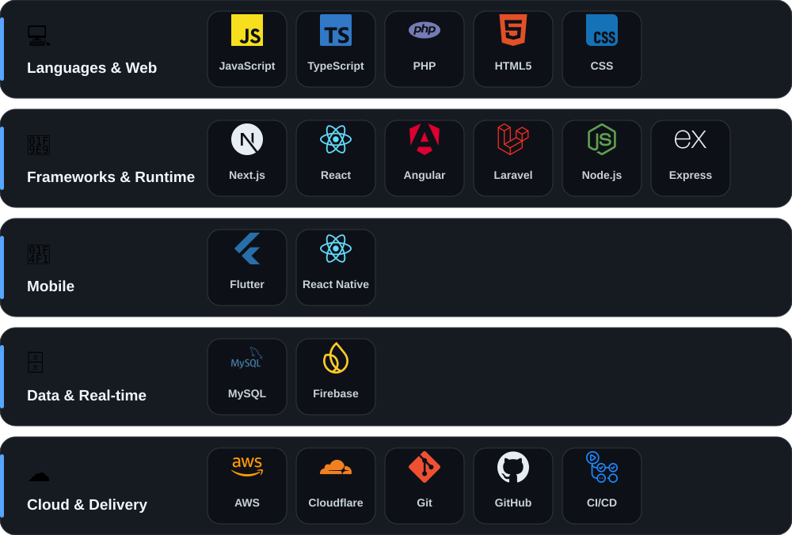
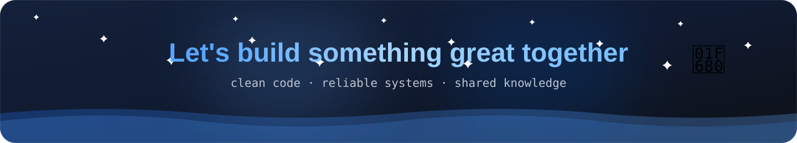

 

 

**⚡ Clean code · 🛡️ Reliable systems · 🌍 Shared knowledge**

## 💼 Professional Summary

I am a **full-stack engineer and product strategist** who turns ideas into clean, reliable software, from the database and API layer to the interface people actually use. I build around **API-driven design, solid authentication and deployment**, and I care about code that stays easy to maintain as it grows.

- 📚 **Passionate about:** operating systems, networks and modern web technologies
- 🎯 **Goal:** to create clean, reliable software and to share knowledge through open source
- 🤝 **Open to:** collaboration, interesting problems and good conversations

## 🚀 Featured Projects

  

  
  
  
  

## 🛠️ Tech Stack

 

